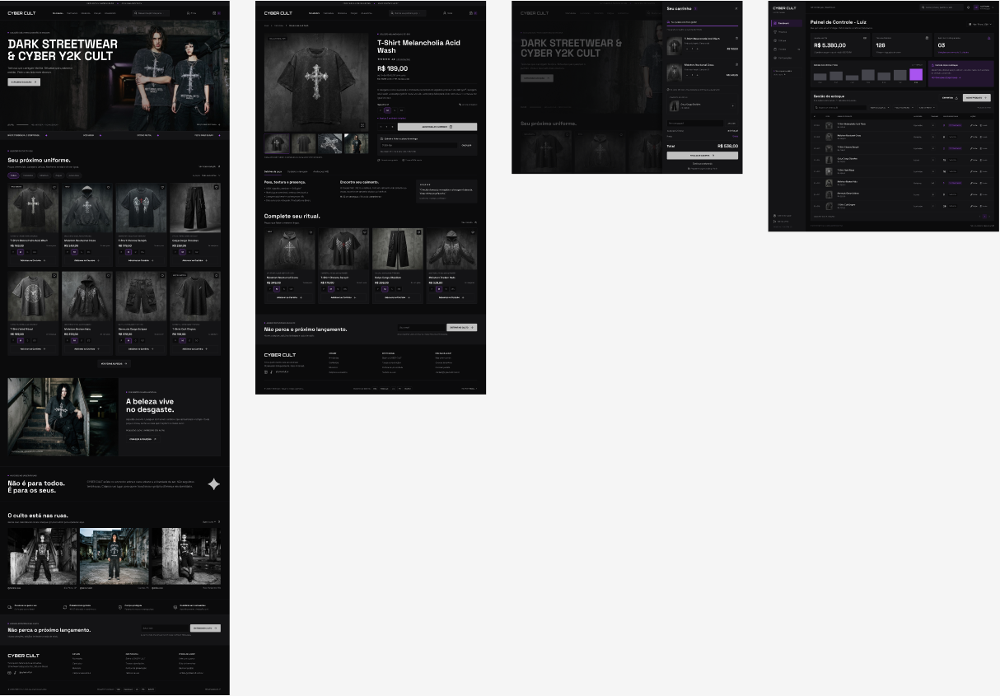
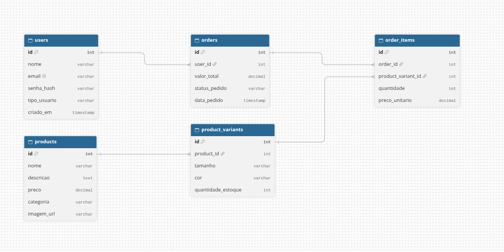

# 🎨 Documento de Análise, Design e Banco de Dados (Fase 2)

> 📥 **Download da Versão Oficial:** [Clique aqui para baixar o PDF completo da Fase 2](Documento_Fase2_Design_e_Banco.pdf)

---

**Projeto:** Sistema de Gerenciamento e Vendas para Loja de Roupas (Cyber Y2K / Dark Streetwear)  
**Responsável:** Luiz  

---

## 1. Especificação da Interface e Design System (UI/UX)

### 1.1 Diretrizes Estéticas
- **Estilo Visual:** Dark Mode / Cyber Y2K / Underground Streetwear
- **Paleta de Cores:**
  - Fundo Principal: `#0B0B0C` (Preto Profundo)
  - Cards e Elevações: `#141416` com bordas finas em `#242428`
  - Texto Principal: `#FFFFFF` (Branco)
  - Texto Secundário: `#8E8E93` (Cinza Prateado)
  - Destaques (Botões/Badges): `#C0C0C0` (Prata Metálico) e Roxo Neon (`#A855F7`)
- **Tipografia:** Títulos em fontes geométricas/cyber (Orbitron / Space Grotesk) e corpo de texto em Inter / Roboto.

### 1.2 Protótipo das Telas (Figma)
1. **Home / Vitrine:** Banner principal da coleção, catálogo em grid com cards de roupas (incluindo foto, preço, tamanhos P, M, G, GG e botão de compra).
2. **Página de Detalhes do Produto:** Galeria de imagens, seletor de variações (tamanho/cor), alerta de estoque restrito e botão "Adicionar ao Carrinho".
3. **Carrinho Lateral (Drawer):** Modal deslizante com resumo dos itens, alteração de quantidade, subtotal e botão de checkout.
4. **Painel Administrativo:** Dashboard com métricas de vendas e tabela de gerenciamento de estoque/catálogo.

---

## 2. Modelagem do Banco de Dados (Diagrama ER)

Para atender a todas as regras de negócio da loja (gerenciamento de produtos, variações de estoque por tamanho/cor e registro de pedidos), o banco de dados relacional (PostgreSQL) foi estruturado em 5 tabelas principais:

### 2.1 Visualização do Diagrama ER

### 2.2 Estrutura das Tabelas

#### 1. Tabela: `users` (Usuários do Sistema)
Armazena os dados cadastrais tanto dos clientes da loja quanto dos administradores.
- `id` (INT - PK): Identificador único do usuário.
- `nome` (VARCHAR): Nome completo.
- `email` (VARCHAR): E-mail de acesso.
- `senha_hash` (VARCHAR): Senha criptografada.
- `tipo_usuario` (VARCHAR): Perfil ("admin" ou "cliente").
- `criado_em` (TIMESTAMP): Data e hora do cadastro.

#### 2. Tabela: `products` (Catálogo de Roupas)
Armazena as informações gerais das peças de vestuário.
- `id` (INT - PK): Identificador único do produto.
- `nome` (VARCHAR): Ex: "T-Shirt Melancholia Acid Wash".
- `descricao` (TEXT): Detalhes da peça e tecido.
- `preco` (DECIMAL): Preço base do produto.
- `categoria` (VARCHAR): Ex: "Camisetas", "Moletons", "Calças".
- `imagem_url` (VARCHAR): Caminho da imagem da roupa.

#### 3. Tabela: `product_variants` (Estoque e Variações)
Relaciona cada produto com seus tamanhos, cores e saldo de estoque individual.
- `id` (INT - PK): Identificador único da variação.
- `product_id` (INT - FK): Referência ao produto pai em `products`.
- `tamanho` (VARCHAR): Tamanho da peça ("P", "M", "G", "GG").
- `cor` (VARCHAR): Cor da peça (ex: "Preto Acid Wash").
- `quantidade_estoque` (INT): Saldo atual disponível para venda.

#### 4. Tabela: `orders` (Pedidos de Venda)
Registra as compras e vendas finalizadas na loja.
- `id` (INT - PK): Identificador único do pedido.
- `user_id` (INT - FK): Referência ao cliente em `users`.
- `valor_total` (DECIMAL): Somatório final do pedido.
- `status_pedido` (VARCHAR): Status ("Pendente", "Aprovado", "Enviado").
- `data_pedido` (TIMESTAMP): Data e hora da compra.

#### 5. Tabela: `order_items` (Itens do Pedido)
Armazena quais variações de roupas e quantidades foram compradas em cada pedido.
- `id` (INT - PK): Identificador único do item.
- `order_id` (INT - FK): Referência ao pedido em `orders`.
- `product_variant_id` (INT - FK): Referência à variação em `product_variants`.
- `quantidade` (INT): Quantidade comprada.
- `preco_unitario` (DECIMAL): Valor da peça no momento da compra.

---

### 2.3 Mapeamento dos Relacionamentos
- `users` (1) ── (N) `orders`
- `products` (1) ── (N) `product_variants`
- `orders` (1) ── (N) `order_items`
- `product_variants` (1) ── (N) `order_items`
